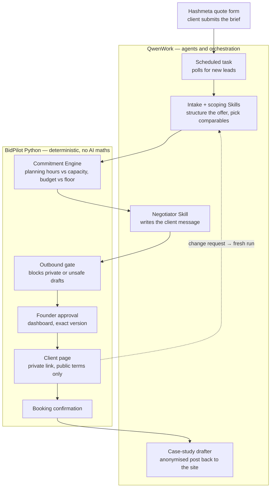
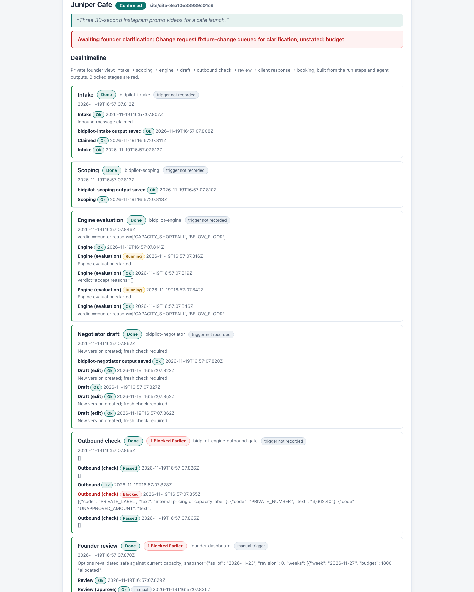
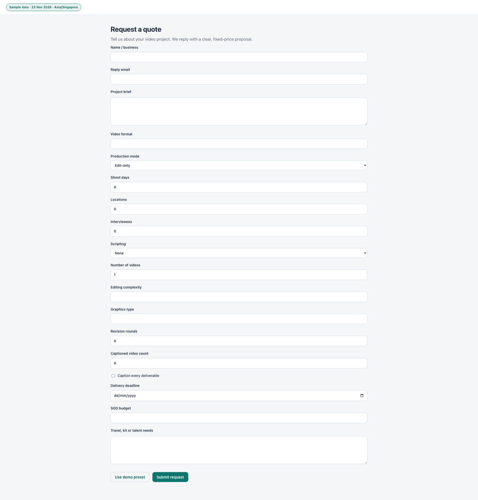
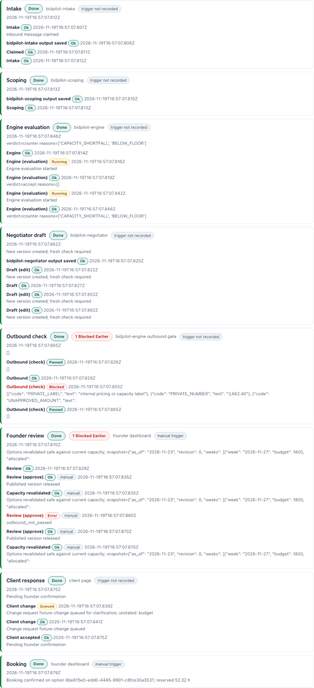
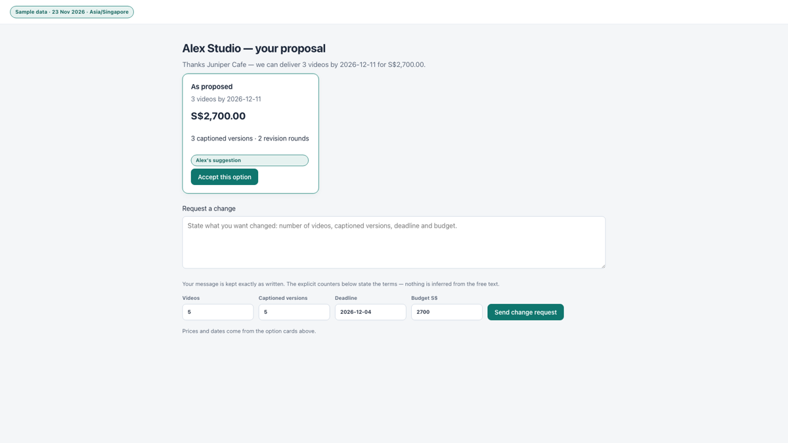

# BidPilot

BidPilot is an AI sales desk for one-person service businesses. QwenWork agents turn website
inquiries into safe, founder-approved proposals that a deterministic Commitment Engine checks
against real capacity, cost floors and private data — so the business only promises what it can
actually deliver.

This is a hackathon entry for **QwenWork x Hashmeta AI OPC**, shown with a sample video producer
("Alex Studio") and synthetic data only. Every figure comes from the engine's pinned sample cases
and is verified by the test suite.

> **Demo status (verified reality).** The capacity/calendar figures are **sample seed data**, not a
> live calendar. The lead poller is a QwenWork **scheduled task** in the intended design, but until a
> genuine timed run has been observed the demo triggers it **manually with Run Now**. **No demo video
> has been generated by QwenWork** — the script in [`docs/SUBMISSION.md`](docs/SUBMISSION.md) is a
> plan only; video production is out of scope.

## How a deal flows



A buyer can start a private conversation, upload a reference video and point to the moments they want Alex to recreate. QwenWork can discuss the brief directly, interpret timestamped frames and retrieve relevant studio work. BidPilot prices the resulting scope against Alex’s history, rate card, cost floor and availability. Alex reviews the estimate and sees how a booking would affect other open proposals.

Alex approves the exact commercial terms before BidPilot releases a private proposal website. The buyer can watch examples, request a different creative direction or select a package. After booking, additional work goes through a priced amendment with buyer and founder approval. At closeout Alex records the work actually delivered and the hours spent so eligible jobs can inform the next quote. [Run the local buyer and founder workflow](docs/RUNNING.md).

## QwenWork vs Python

QwenWork is the product's engine; the Python code is a set of plain, deterministic tools it calls
over MCP. Agent reasoning never lives in Python, and no model does arithmetic.

| QwenWork (agents & orchestration) | BidPilot Python (deterministic tools over MCP) |
| --- | --- |
| Scheduled inquiry poller (manual **Run Now** fallback until a genuine timed run is observed) | `mcp_server.py` — the scoped MCP tool surface |
| `bidpilot-intake` — extract the brief, structure the offer | `engine` — pricing/evaluation: hours, capacity, floor, verdict, options |
| `bidpilot-scoping` — choose comparable past jobs | Outbound gate — blocks private/unsafe draft text |
| `bidpilot-negotiator` — write the client message from public options | `server.py` — founder dashboard + client proposal pages |
| `bidpilot-run` / `bidpilot-runtime` — orchestrate a deal end to end | `core.py`, `db.py`, `capacity.py` — deal state, storage, capacity model |
| Hashmeta AI website and the anonymised case study | The per-deal **agent timeline** (built from `run_steps` + `agent_outputs`) |

The MCP tool surface each Skill uses is documented in [`QWENWORK_MCP.md`](QWENWORK_MCP.md) and
[`bidpilot-build-guide/bidpilot-runtime/SKILL.md`](bidpilot-build-guide/bidpilot-runtime/SKILL.md).

## Screenshots

The founder dashboard, quote form and client page share one calm design system, and each deal has a
private founder-only timeline of every agent step.

| Founder dashboard — deal card with the per-deal agent timeline (blocked stages in red) | Public quote form |
| --- | --- |
|  |  |

| Full deal timeline: intake → scoping → engine → draft → outbound check → review → client response → booking | Client proposal page (public terms only) |
| --- | --- |
|  |  |

The timeline shows each step's skill/agent name, status, time, trigger (manual vs scheduled) and a
short private note. It is founder-only — client pages never expose it, private hours, the cost
floor, capacity or other clients.

## Run it

See [`docs/RUNNING.md`](docs/RUNNING.md) for full setup (Python 3.11+, the MCP connectors, and how
to reset the sample data). Quick start:

```sh
python3 -B BidPilot/server.py
```

Open the owner URL printed in the terminal (keep it private — it holds the per-launch session
token). The sample intake form is at `http://127.0.0.1:8765/quote`.

## Tests

```sh
# main suite — 137 tests (5 currently skipped)
(cd BidPilot && python3 -B -m unittest discover -p 'test_*.py')
# Commitment Engine unit tests — 6 tests
(cd BidPilot/bidpilot-engine && python3 -B -m unittest -v test_engine.py)
# full demo-flow replay over HTTP + MCP
python3 -B BidPilot/scripts/demo_smoke.py
```

## Deployment

BidPilot ships as a **loopback-only demo** on synthetic sample data: `server.py` is a Python
standard-library HTTP server bound to `127.0.0.1`, the owner session token is generated per launch
and printed to the console (never logged or written to disk), and state lives in a local SQLite
file. That is deliberate for the hackathon — it is not production-hardened.

To run it for real:

- **Serve the app** behind a reverse proxy (nginx or Caddy) terminating TLS, as a `systemd` service
  or container, instead of the bare loopback server.
- **Authenticate properly.** Replace the per-launch owner token with real auth (OIDC/session) and
  role checks; the founder dashboard, client token pages and MCP tool surface each need their own
  authorization boundary.
- **Persist and back up state.** Move off the local SQLite file to a backed-up volume or a managed
  database, and keep `*.db` and `server.log` out of the repo (see `.gitignore`).
- **Run the agents in QwenWork.** The intake/scoping/negotiator/run Skills execute as QwenWork
  scheduled tasks in the workspace and reach BidPilot through the MCP bridge; point
  `BIDPILOT_MCP_DB` at the same database the server uses. In the demo these are triggered manually
  with **Run Now** until a genuine timed run has been observed.
- **Host the website separately.** The client-facing quote form and case studies live on the
  Hashmeta site, which talks to BidPilot through the same scoped tools.
- **Keep the engine deterministic and tested.** Pricing, capacity and the outbound gate stay in
  plain Python under CI so no model performs arithmetic or releases unsafe text.

## Layout

- `BidPilot/` — the working Python app (engine, `core.py`, `db.py`, `capacity.py`, `server.py`,
  `mcp_server.py`, and the `test_*.py` suites).
- `bidpilot-build-guide/` — the build guide, the QwenWork build prompt, and the agent Skills. Its
  `bidpilot-engine/` intentionally mirrors `BidPilot/bidpilot-engine/`; keep both in sync.
- `docs/` — [`RUNNING.md`](docs/RUNNING.md), [`SUBMISSION.md`](docs/SUBMISSION.md) and this
  README's images.
- `tools/`, `qwenwork-mcp.json`, `qwenwork-bidpilot-mcp.json`, [`QWENWORK_MCP.md`](QWENWORK_MCP.md)
  — the local MCP bridge that connects QwenWork to this project.

See [`AGENTS.md`](AGENTS.md) for the contributor guide and [`docs/SUBMISSION.md`](docs/SUBMISSION.md)
for the hackathon submission.
