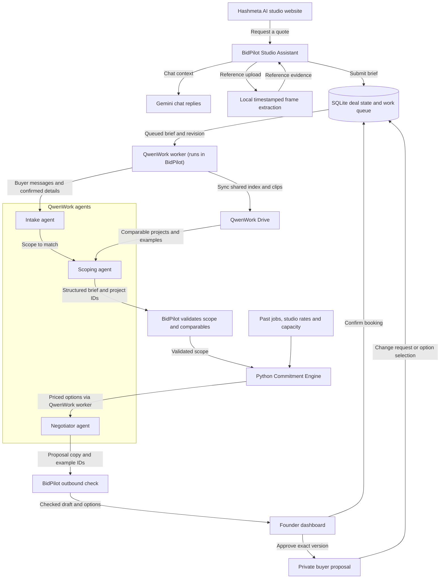
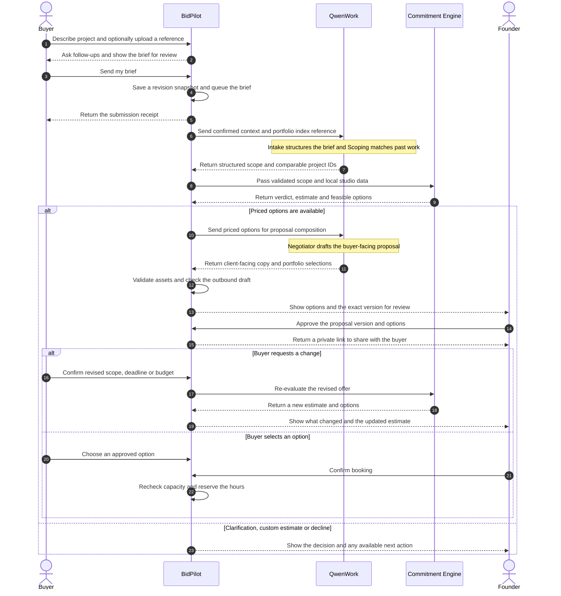
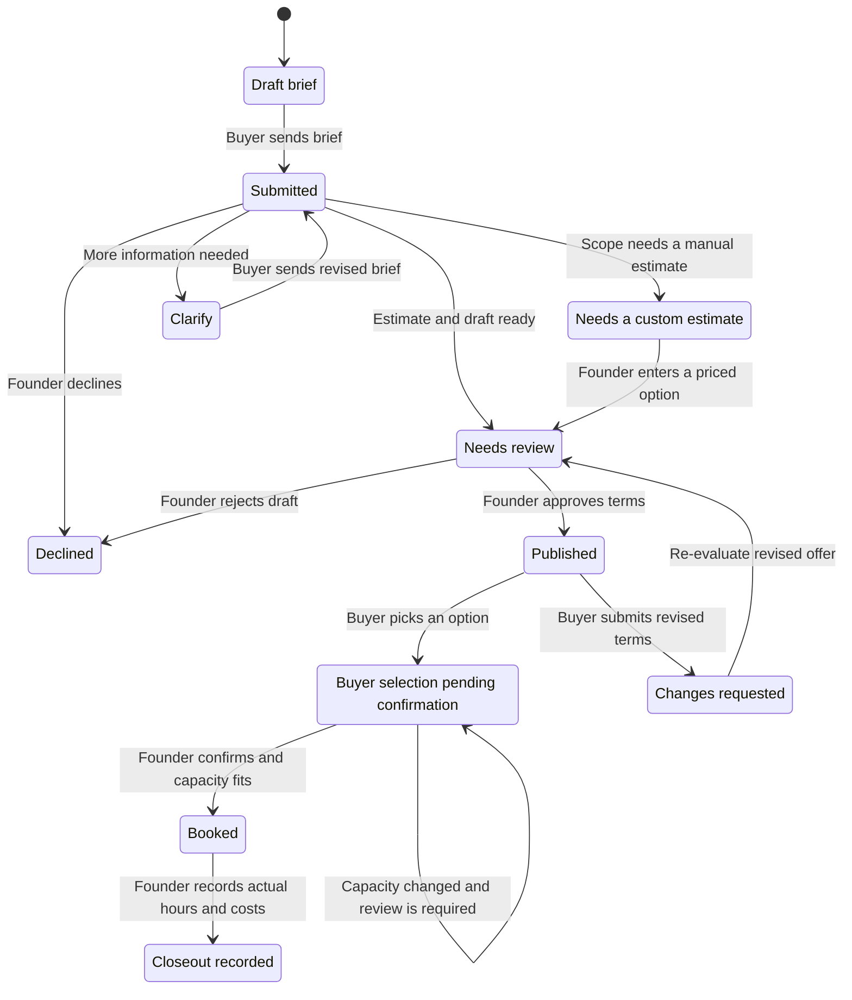

# BidPilot

Built for **QwenWork × Hashmeta AI OPC**. The demo follows **Alex Tan Productions**, a one-person video production studio.

> The AI sales desk for content creators who make videos for clients.

When a client sends an inquiry, a solo content creator has three decisions to make. **Should I take this job? Can I deliver it on time? What should I charge?**

BidPilot turns a client brief into a decision the founder can act on. It compares the scope with past work, checks the studio calendar and minimum viable price, and works out what the founder could offer. If the request is too tight, BidPilot can price a smaller scope, a later deadline, or a phased delivery. The founder reviews the terms before the client receives a proposal.

**Try the demo** with [sample deals and no API keys](#getting-started), or follow the [presenter walkthrough](#presenter-walkthrough) for the live workflow.

## Table of contents

- [Why BidPilot](#why-bidpilot)
- [What is built](#what-is-built)
- [Presenter walkthrough](#presenter-walkthrough)
- [General architecture](#general-architecture)
- [QwenWork OpenAPI and Drive](#qwenwork-openapi-and-drive)
- [Hashmeta AI studio website](#hashmeta-ai-studio-website)
- [Commitment Engine and founder controls](#commitment-engine-and-founder-controls)
- [Demo data](#demo-data)
- [Technology stack](#technology-stack)
- [Getting started](#getting-started)
- [Configuration](#configuration)
- [Testing](#testing)

## Why BidPilot

A content creator taking on client video work has to price the project while keeping track of shoots, edits, revisions, and deadlines already promised to other clients. Take on too much and an existing delivery can slip. Charge too little and a busy week can still lose money.

BidPilot puts those decisions in one place.

| Founder question | What BidPilot shows |
| --- | --- |
| **Should I take it?** | A recommendation to accept, counter, clarify, or decline, with the reason. |
| **Can I deliver it?** | Estimated production hours against available hours before the deadline, including blocks and confirmed bookings. |
| **What should I charge?** | A proposed selling price, the studio’s private minimum, and feasible alternatives when budget or timing is tight. |

BidPilot starts with paid video projects. The workflow could extend to other project-based solo businesses, such as photographers and web designers, with intake questions and pricing rules tailored to each service.

## What is built

| Surface | What it does |
| --- | --- |
| **Studio Assistant** | Collects the production brief in chat. Buyers can upload a reference clip, point to specific moments, and confirm what they want before submitting. |
| **Founder dashboard** | Shows the brief, estimate, proposal versions, and a before-and-after comparison when a buyer changes the request. |
| **Studio calendar** | Tracks weekly hours, blocks, and bookings. Calendar edits refresh affected draft estimates, and the founder can preview how a booking would affect other open proposals. |
| **Studio tools** | Provides a shareable portfolio library and a **Production estimates** price list the founder can use to build a custom quote. |
| **Private proposal page** | Shows the approved options and shared examples. The buyer can pick an option or request a change. |
| **Booking and closeout** | The founder confirms the booking after the buyer chooses. Completed work can contribute actual hours and fees to future estimates. |

## Presenter walkthrough

| Step | Show | What to say |
| --- | --- | --- |
| 1 | **Buyer intake** at `/inquire` | “A café wants videos for a launch. The buyer can describe the job, upload a reference, and point to the parts they want before sending the brief.” |
| 2 | **Brief and estimate** in the founder dashboard | “Alex sees the scope, estimated hours, proposed quote, and whether the work fits before the deadline.” |
| 3 | **Counterproposal** | “The buyer wants more videos sooner at the same budget. Alex can compare what changed and offer a scope or schedule the studio can deliver.” |
| 4 | **Private proposal page** | “Alex approves the exact terms. The buyer opens one link, compares the options, and picks one or requests another change.” |
| 5 | **Calendar and booking** | “Alex checks the impact on other jobs and confirms the booking. BidPilot allocates those hours in the studio calendar.” |

For the keyless walkthrough, open **Juniper Cafe** for the counterproposal, **Bayside Bistro** for a published proposal, and **Calendar** for existing bookings. Use the configured live workflow to show a fresh assistant conversation and QwenWork processing a newly submitted brief.

## General architecture

Hashmeta AI provides the public studio website. BidPilot serves the buyer chat, founder dashboard and private proposal page. QwenWork turns submitted briefs into structured scope and drafts proposal copy. Python and SQLite own the commercial terms, calendar and deal history.

### System components



The QwenWork worker runs as a background thread in BidPilot and calls QwenWork’s OpenAPI to start cloud sessions and track their results. Intake and Scoping share one brief session. The worker opens a separate Negotiator session after the Commitment Engine returns priced options. Gemini is the default buyer chat provider, with a QwenWork option for chat. The [MCP interface](QWENWORK_MCP.md) supports connector-based tools and fixture replays.

### Data flow from inquiry to booking



### Deal lifecycle



These stages describe the workflow across the inquiry, deal and proposal records. A buyer’s selection remains pending until the founder confirms the booking and the current calendar has room.

## QwenWork OpenAPI and Drive

QwenWork runs the reasoning and writing steps between a submitted brief and a founder-ready proposal. BidPilot connects through OAuth, opens cloud sessions through OpenAPI, and records work status against the matching inquiry revision or proposal version.

| QwenWork agent | Receives | Produces | BidPilot validates |
| --- | --- | --- | --- |
| **Intake** | Buyer messages, confirmed production facts and the intake question bank | Structured offer fields such as deliverables, editing, deadline and budget, or questions when scope is incomplete | Current inquiry revision, required fields and grounded production facts |
| **Scoping** | Brief and the portfolio index on QwenWork Drive | Comparable project IDs with reasons and a suggested example clip | Known project IDs and portfolio assets cleared for sharing |
| **Negotiator** | Eligible priced options and the allowed portfolio asset IDs | Client-facing headline, introduction, sections and example selections | Asset references, current version and outbound draft checks before release |

The **Drive** integration uploads an index and clips marked shared in Studio Tools. The index describes format, production scope and examples. BidPilot keeps private rates, minimum prices, estimated hours and calendar capacity in its local data. The worker can ask QwenWork to repair an invalid response and checks for a stale revision before applying a result.

See the [OpenAPI client](BidPilot/qwenwork_api.py), [worker and Drive sync](BidPilot/qwenwork_runtime.py), [commercial stages](BidPilot/qwenwork_commercial.py), and [intake, scoping and negotiator skills](bidpilot-build-guide/).

## Hashmeta AI studio website

Hashmeta AI provides the public-facing studio site in the demo. Its **Request a quote** page is the entry point for a prospect coming from the studio’s website. The deployment supports embedding BidPilot’s buyer chat site or opening the chat directly over HTTPS.

| Part of the handoff | Responsibility |
| --- | --- |
| **Hashmeta studio site** | Presents the studio and brings prospective clients to the **Request a quote** page. |
| **Quote embed** | Loads BidPilot’s `/inquire` page in an iframe. The repo’s embed shell also offers a link to open the chat in a new tab. |
| **BidPilot buyer service** | Serves the chat, uploads and brief submission. The private inquiry continues at `/i/<token>` and the approved proposal is served at `/p/<token>`. |
| **BidPilot founder app** | Owns pricing, the studio calendar, approval and booking. The deployment keeps the founder dashboard on the local app. |

The app’s `--public-origin` identifies the buyer service’s HTTPS address. `--embed-origin` lists the sites allowed to frame the inquiry. See the [configured Hashmeta quote page](https://alex-studio.geo.hashmeta.tech/request-a-quote), [embed shell](bidpilot-embed/index.html), and [deployment configuration](BidPilot/deploy/run_server.sh).

## Commitment Engine and founder controls

| Decision | Inputs | Output |
| --- | --- | --- |
| **Estimate effort and price** | Validated scope, compatible past jobs, eligible completed actuals, and the engine’s effort and rate rules | Planning hours, proposed price and the internal minimum. Supported scopes with sparse history use baseline effort and the engine rate card. The founder can estimate custom work through the **Production estimates** price list. |
| **Check delivery capacity** | Weekly working hours, blocked hours, confirmed reservations, a capacity buffer and the requested deadline | Available hours and a fit check. A booking preview shows how reserving those hours could affect open proposals. |
| **Work out a counteroffer** | Original scope and the budget, pricing and capacity constraints | Feasible options such as a smaller scope, a later date or phased delivery, where the evaluated scope supports them. |
| **Approve the proposal** | A selected option set, the proposal version and the outbound check | A tokenized link to the approved version. The outbound price check protects the studio’s minimum acceptable price. |
| **Confirm the booking** | The buyer’s selection and the latest capacity ledger | An atomic reservation of hours and a confirmed booking. If the updated calendar cannot fit the work, the founder sees a capacity conflict and the selection stays pending. |

See the [estimator](BidPilot/estimating.py), [engine rules](BidPilot/bidpilot-engine/engine.py), [capacity ledger](BidPilot/capacity.py), and [proposal and booking logic](BidPilot/core.py).

## Demo data

The repository ships with synthetic deals, historical pricing and effort inputs, a sample weekly calendar, and portfolio clips. The dashboard uses the app’s own editable studio calendar. The seed script creates example states through the service layer, including priced drafts, published proposals, a counterproposal, and confirmed bookings. It seeds a local database and sends no email.

## Technology stack

- **App and UI** — Python 3.11+, standard-library HTTP server, server-rendered HTML, CSS, and JavaScript.
- **State and business rules** — SQLite plus CSV inputs for rates, effort, past projects, and baseline calendar capacity.
- **AI integrations** — QwenWork OpenAPI and Drive for the commercial workflow, Gemini by default for buyer chat, and MCP for the separate tool interface.
- **Media and tests** — Local FFmpeg decoding via `imageio-ffmpeg`, Python `unittest`, and Playwright for browser coverage.

## Getting started

From the repository root, start the app on its own demo database.

```sh
python3 -m venv .venv
.venv/bin/python -m pip install -r BidPilot/requirements-media.txt

.venv/bin/python -B BidPilot/server.py --db .venv/bidpilot-demo.db --owner-token-file none
```

Once the founder URL appears, seed the sample deals from a second terminal at the repository root.

```sh
.venv/bin/python -B BidPilot/seed_sample_deals.py --db .venv/bidpilot-demo.db
```

Open the founder URL printed in the first terminal and keep it private. The default port is `8765`. Pass `--port 8766` if it is already in use. The seeded dashboard needs no API keys. A fresh buyer chat and automated quote require the provider settings below.

## Configuration

| Capability | Setup |
| --- | --- |
| **Buyer chat** | Add `GEMINI_API_KEY` to the repository-root `.env`, using [`.env.example`](.env.example) as a starting point. `BIDPILOT_STUDIO_ASSISTANT=qwenwork` routes chat to the configured QwenWork runtime. |
| **Live brief-to-proposal workflow** | Set `BIDPILOT_QWENWORK_EVENT_RUNTIME=1` and configure a QwenWork OAuth client with `BIDPILOT_QWENWORK_CLIENT_ID` and `--qwenwork-redirect-uri`. Use a registered HTTPS redirect to the app’s `/qwenwork/callback` and open `/qwenwork/connect` as the founder to authorize it. |
| **Hashmeta website embed** | Point the quote page at `/inquire` through a buyer-facing HTTPS origin. Configure `--public-origin` and allow the embedding site with `--embed-origin`. |
| **Proposal email API** | The founder dashboard publishes a shareable link. For delivery through the separate email endpoint, configure a public HTTPS proposal origin, sender, and SMTP credentials. See [proposal delivery setup](docs/RUNNING.md#approve-and-send-configuration). |

The local server binds to `127.0.0.1`. The [macOS launcher](BidPilot/start_all.sh) is specific to the demo deployment. See the [MCP guide](QWENWORK_MCP.md) for connector-based workflows.

## Testing

```sh
# Replay the deal flow over HTTP and MCP using fixture agent responses
.venv/bin/python -B BidPilot/scripts/demo_smoke.py

# Run the app and engine suites
(cd BidPilot && ../.venv/bin/python -B -m unittest discover -p 'test_*.py')
(cd BidPilot/bidpilot-engine && ../../.venv/bin/python -B -m unittest -v test_engine.py)
```

The fixture replay uses synthetic data and covers intake, pricing, revised offers, the outbound check, approval, and booking. For browser test dependencies, see the [CI workflow](.github/workflows/tests.yml).
